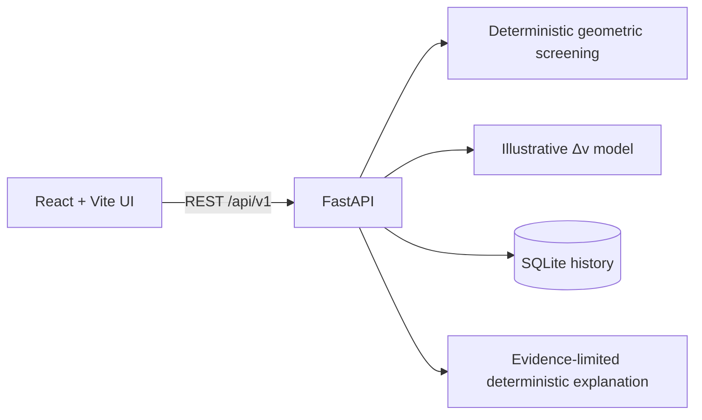

# RAKSHAM

**Protecting Every Orbit Through Predictive Intelligence.**  
*Orbital Intelligence. Predictive Safety. Explainable Decisions.*

RAKSHAM is a research and educational prototype for investigating orbital close-approach screening and hypothetical maneuvers. Its local demo works without credentials or external data and calculates results from a deterministic, clearly labelled synthetic scenario.

> **Research prototype, not flight-certified software.** Demo coordinates and outputs are synthetic. The current propagator is a constant-velocity toy model in an illustrative shared inertial frame. Its geometric separations and heuristic priority labels are not collision probabilities, safety assessments, or maneuver recommendations.

## What works

- React/TypeScript operations UI with responsive Mission Control, a schematic scene, event center, registry, explorer, maneuver lab, analytics, and status views.
- FastAPI API with validated screening/simulation inputs, persistent SQLite event and simulation history, CSV exports, health/system status, and deterministic explanation fallback.
- Deterministic pair screening, coarse time sampling with local 1-second refinement, heuristic distance bands, and a bounded instantaneous along-track velocity perturbation example.
- Explicit synthetic indicators, limits, and data provider status. The scene is schematic and is not an orbital propagation plot.

This first implementation deliberately does not claim SGP4/OMM ingestion, full orbital propagation, PostgreSQL/Alembic, collision probability, authentication, or operational maneuver planning. See [docs/LIMITATIONS.md](docs/LIMITATIONS.md).

## Architecturee



The API returns positions and event distances from a deterministic synthetic fixture. SQLite persists screening events and simulation outcomes across backend restarts. The browser never substitutes hardcoded event results for API responses.

## Repository

```text
backend/       FastAPI application, Python project configuration
frontend/      React, TypeScript and Vite user interface
docs/          Method, API, source and limitation notes
scripts/       Local benchmark
.github/       CI workflow
docker-compose.yml, Dockerfiles, .env.example
```

## Local setup (Windows PowerShell)

Install Python 3.11+ and Node.js 20+. Open two terminals in the repository root.

```powershell
Copy-Item .env.example .env
py -3.11 -m venv backend\.venv
backend\.venv\Scripts\Activate.ps1
python -m pip install -e .\backend[dev]
python -m uvicorn app.main:app --app-dir backend --reload --port 8000
```

In a second terminal:

```powershell
cd frontend
npm install
npm run dev
```

Open `http://localhost:5173`; API docs are at `http://localhost:8000/docs` and health at `http://localhost:8000/health`. SQLite initializes on first API request at `backend/raksham.sqlite3` (or `RAKSHAM_DB_PATH`). No separate migration command is needed in this prototype.

macOS/Linux backend equivalent: `python3 -m venv backend/.venv`, activate with `source backend/.venv/bin/activate`, then `python -m pip install -e './backend[dev]'` and run the same uvicorn command.

## Demo workflow

1. Start the API and frontend.
2. Select **Run screening** in Mission Control. It screens the built-in synthetic fixtures over 24 hours.
3. Inspect computed events in Collision-Risk Center.
4. Open Maneuver Decision Lab, set Δv, and run a candidate against the first saved event.
5. Export screening or simulation CSVs in Analytics.

Demo data are deterministic in structure but use the current UTC timestamp as their epoch. Screening/simulation results persist in SQLite. To clear local history, stop the API and remove `backend/raksham.sqlite3` (this deletes only local generated demo history).

## Configuration and Docker

Copy `.env.example` to `.env`. `RAKSHAM_DB_PATH` controls the SQLite database location; `RAKSHAM_CORS_ORIGINS` is a comma-separated allowlist. `VITE_API_URL` optionally overrides the browser API base URL. No API credentials are required. CelesTrak refresh is intentionally not implemented yet and the status endpoint reports that plainly.

With Docker Engine and Compose installed, run `docker compose up --build`, then open `http://localhost:5173`. Compose persists SQLite in a named volume. Docker could not be verified in the authoring environment because the Docker executable is unavailable.

## Checks

```powershell
python -m pip install -e .\backend[dev]
python -m pytest backend\tests
cd frontend; npm install; npm run build; npm test
```

`python scripts/benchmark_screening.py --objects 12 --hours 6` measures the current implementation; the underlying implementation has a request cap of three fixture objects and a 72-hour horizon, so the script reports a scalable synthetic pair workload separately from API limits. Use its output as an environment-specific measurement, not a performance claim.

## Further documentation

- [Architecture](docs/ARCHITECTURE.md) · [Orbital methodology](docs/ORBITAL_METHODOLOGY.md) · [API](docs/API.md)
- [Data sources](docs/DATA_SOURCES.md) · [Limitations](docs/LIMITATIONS.md) · [Development](docs/DEVELOPMENT.md)
- [Contributing](CONTRIBUTING.md) · [Security](SECURITY.md)

## License and attribution

MIT; see [LICENSE](LICENSE). CelesTrak is identified as a planned public data source; this build does not retrieve or redistribute its data.
